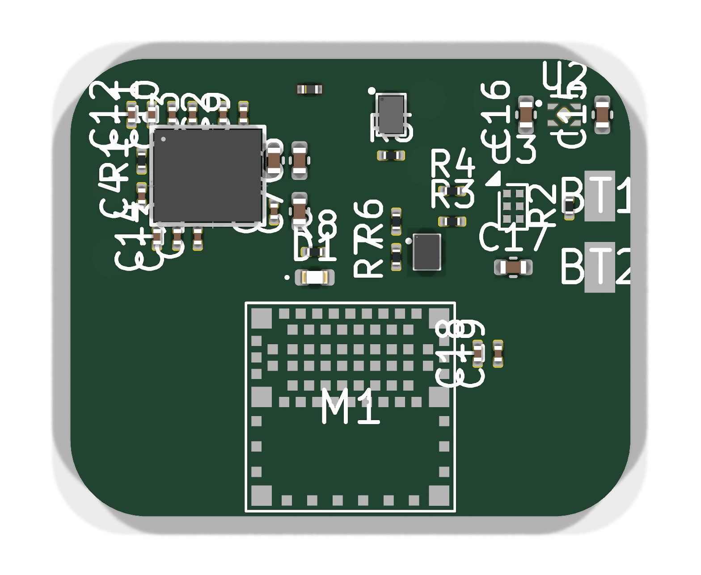

# OCK-P1 pod board

A glucose-only derivative of [Biocoin v1.3](https://github.com/ProfDrewHall/Biocoin), sized for the B1 pod (`mechanical/product_B1.py`).



| | Biocoin v1.3 | OCK-P1 |
| --- | --- | --- |
| Board | 26 mm round, 6 layers, 0.94 mm | 22 × 18 mm, 6 layers HDI, 0.8 mm |
| Radio/MCU | MDBT50Q (nRF52840), 10 × 15.5 × 2.2 mm | ISP1807 (nRF52840 SiP, antenna inside), 8 × 8 × 1 mm |
| Analog front end | AD5940 + 4:1 mux, pH buffers, iontophoresis, strain/temp | AD5940 only, WE/RE/CE direct |
| Power | MAX17270 buck-boost, 110 mAh coin cell | TPS7A0230 LDO, bq25100 charger, ~12 mAh 2 mm pouch |
| Sensor interface | 20-pin ZIF (10 mating cycles) | 3 ENIG spring-contact pads |
| Dock interface | Pogo pads | VBUS, GND, SWDIO, SWDCLK pads |
| Pod | 36 × 31 × 8.5 mm | 27.6 × 23.4 × 6.0 mm |

**What carries over unchanged:**
- **AD5940 circuit:** every ball-to-net connection and decoupling value is copied from the pinned Biocoin layout and schematic.
- **Firmware:** the nRF52840 port pins are the same: SPI on P0.13/14/15, CS P0.04, interrupt P0.05, reset P0.02, AFE power P0.26 (active low through the same dual P-FET), battery divider P0.29, LED P0.20. Biocoin firmware, or the patched build in `firmware/biocoin-patches`, should run without a new variant. Pins for parts that were removed drive nothing.

## Power

`python3 power_budget.py [cell_mAh]` adds up datasheet currents:

| Load | µA |
| --- | ---: |
| AD5940 low-power potentiostat loop, continuous | 8.5 |
| AD5940 ADC, 50 ms burst every 30 s | 3.4 |
| nRF52840 idle with RTC | 3.0 |
| BLE events and notifications | 1.6 |
| Divider, buffer, LDO, charger leakage, LED | 1.2 |
| **Total** | **17.7** |

That is about 6.4 mAh per 15-day wear, or about 23 days per charge on a 12 mAh cell. The BLE energy per event is an estimate; measure it on hardware.

## Build

```sh
./make.sh        # needs KiCad 10; imports Biocoin, regenerates footprints, board, DRC, renders
```

`build_board.py` holds the netlist and placement; it is the design source (no schematic yet). `ock_p1.pretty` contains footprints extracted from the Biocoin layout (AD5940 CB-56-3, CSD75208 dual P-FET, MAX44264, ferrite) plus the ISP1807 land pattern built from its datasheet drawing.

## Status

| Step | State |
| --- | --- |
| Netlist, placement, antenna keep-out, via-in-pad escapes | Done |
| DRC (errors) on the placed board | 0 violations, 106 unrouted connections |
| Routing | Not done. `route_board.py` drives Freerouting; running it needs approval for the downloaded jar |
| Post-route DRC, Gerbers, drill, pick-and-place | Not done |
| Schematic | Not done; netlist lives in `build_board.py` |

Open items before fabrication:
- **CLPF value:** Biocoin's schematic gives no value for its LPF0 capacitor; 1 µF is a placeholder.
- **ISP1807 land pattern:** positions were measured from the R19 drawing to about ±0.02 mm. Check them against Insight SiP's CAD files.
- **Antenna:** the 4.3 mm keep-out follows the datasheet. The pod plastic and the patient's body will detune it; measure range on hardware.
- **Unprotected interfaces:** VBUS and SWD contact pads have no ESD protection, and WE/RE/CE have no guard ring.
- **Shipping mode:** with no button or ship mode, a stored pod draws about 2 µA.
- **Dock:** needs a new fixture for the bottom pads.
