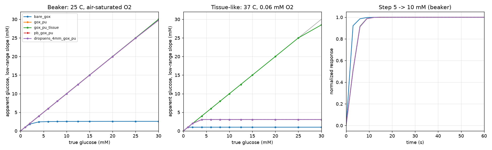

# Electrode model

Dry-lab model of the GOx amperometric glucose electrode: 1D reaction-diffusion
through the layer stack (electrode | enzyme | outer membrane | boundary layer),
ping-pong GOx kinetics in glucose and oxygen, H2O2 collection at the electrode,
acetaminophen as an electroactive interferent, and the Biocoin AD5940 readout
quantization as configured in the pinned firmware.

```sh
python3 models/electrode_model.py            # presets -> models/out/
python3 models/electrode_model.py --mc 200   # + Monte Carlo sensitivity (~4 min)
python3 models/electrode_model.py fit data.csv   # fit outer-membrane permeabilities
python3 models/geometry_2d.py                # A0 layout: edge effect, crosstalk, IR drop
python3 models/electrode_model.py stress     # failure-mode traces + Resilient fixtures (~1 min)
cd models && python3 -m unittest -v          # ~2 min, mostly fit and stress trace generation
```

Needs numpy, scipy, matplotlib.

## What it verifies

The tests check the solver against closed-form limits: series diffusion of
peroxide and acetaminophen (to 0.1%), the glucose-flux-limited regime with
peroxide split by layer resistance (to 3%), mass conservation, grid
convergence, partition versus diffusivity behaviour, and the firmware's
code-to-current formula. The 2D solver is checked against the Saito microdisk
current 4nFDCa (to 1%) and the 1D model, the 3D potential solver against
1/(4κa) and parallel plates, and the fit by recovering known permeabilities
from noisy synthetic data.

## What it found



| Finding | Consequence |
| --- | --- |
| The outer membrane's glucose permeability drives sensitivity and tissue linearity (Spearman ±0.85–0.89). Enzyme loading and Km barely matter while the membrane limits flux. | Spend the effort on the membrane. Sloppy home enzyme loading is tolerable. |
| A membrane that is linear to 30 mM in an air-saturated beaker saturates near 3 mM at tissue oxygen (0.06 mM). | Beaker tests must include low-O2 runs (N2-sparged to ~0.05 mM), otherwise they pass sensors that fail on the body. |
| Linearity at tissue O2 needs O2:glucose permeability of roughly 600 or more, leaving ~3–4 nA/mM on the 1.2 mm A0 disk. | Target spec for the membrane, and the measurement that qualifies it. |
| At 3–4 nA/mM the firmware's 10 kΩ CA gain resolves ~1 mM per ADC count. 160 kΩ gives 0.06 mM; 512 kΩ gives 0.02 mM and still fits 25 mM. | Raise `LptiaRtiaSel` in `echem_ca.cpp` before wet tests with a tissue-grade membrane. |
| Acetaminophen error scales almost entirely with the membrane's acetaminophen:glucose permeability ratio (Spearman 0.98). A Prussian-blue electrode at ~0 V removes it in the model. | Prussian-blue screen-printed electrodes are the cheapest interference fix. |
| A 4 mm commercial screen-printed electrode gives ~11× the current of the A0 disk. | Use commercial strips for the first wet runs; 80 kΩ fits them. |

`out/report.json` holds every number above. `out/synthetic_trace_gox_pu.csv` is
a 24 h raw-current trace (meals, interstitial-fluid lag, drift, noise, ADC
quantization) for exercising the calibration software.

## Fitting the membrane (`fit`)

```sh
python3 models/electrode_model.py fit bench.csv [--preset gox_pu] [--boundary-um 50] [--fit-enzyme] [--out fit.json]
```

`bench.csv` has one steady-state current per row, `#` comments allowed:

```csv
glucose_mM,oxygen_mM,acetaminophen_mM,current_nA,sigma_nA
0,0.26,0,0.1,0.3
5,0.26,0,141.2,4.4
5,0.05,0,138.9,4.3
0,0.26,0.13,36.5,1.4
```

Run a glucose calibration at two O2 levels (air-saturated and N2-sparged,
measured with an O2 probe) and an acetaminophen spike (0 mM glucose is
cleanest). `sigma_nA` is optional (default 3 % + 0.3 nA). The fit returns log-space
permeabilities for glucose, O2 and acetaminophen with Jacobian-based 95 %
intervals, correlations and chi2/dof. `out/example_bench_synthetic.csv` is a
worked input.

| Finding | Consequence |
| --- | --- |
| Synthetic round trip (truth 0.0015 / 0.35 / 0.012, 2 % + 0.3 nA noise, start 2–3× off) recovers glucose 0.00149 (±2 %), O2 0.342 (±10 %), acetaminophen 0.0116 (±9 %). | The two-O2 calibration plus one spike is enough to identify all three. The low-O2 curve sets O2, the spike sets acetaminophen. |
| Enzyme loading cannot be fitted while the membrane limits flux (interval > 3×). | Leave `--fit-enzyme` off unless a low-glucose or fast-step experiment constrains it. |

Peroxide permeability, thicknesses, Km and the stagnant layer are held at the
preset; a wrong fixed value biases the fit. Not yet run on real bench data
(none exists).

## 2D geometry (`geometry_2d.py`)

A0: 1.2 mm Pt disk at x = 8.5 mm, CE strip 1.4 × 6 mm at 5.5 mm, RE strip
1.2 × 3 mm at 3.3 mm (edge gaps WE–CE 1.7 mm, CE–RE 0.9 mm, WE–RE 4.0 mm).

| Finding | Consequence |
| --- | --- |
| The 1D model underestimates the 1.2 mm disk current by 11 % (50 µm stirred) to 14 % (100 µm tissue layer) when the coating extends past the rim; glucose and acetaminophen move together. | A constant factor the calibration absorbs. It does not change selectivity or linearity. |
| With the coating only over the disk, acetaminophen leaks in at the rim: 1D is 36 % low (gox_pu), 84 % low (tissue membrane); a 0.5 mm overlap cuts this to 11 % / 29 %. | Coat at least 0.5 mm beyond the disk. Verify rejection on the real layout, not a 4 mm strip. |
| In a stirred or tissue-like layer (≤ 100 µm) no peroxide reaches the CE or RE (< 1e-6 of production). In a quiescent 5 mm layer the RE edge sees ~1.2 µM, 13 % of the WE surface level (planar upper bound: CE captures 5 %, RE 0.8 µM, 3.3 µM without the CE). | The CE between WE and RE already shields the RE. No change needed; avoid long quiescent soaks with glucose above 20 mM. |
| Uncompensated WE–RE resistance 267 Ω in 1.5 S/m PBS (WE–CE 310 Ω, disk-to-infinity 278 Ω): 0.04 mV at 5 mM, 0.19 mV at 25 mM (gox_pu, 0.7 µA). Mesh-converged to 0.3 %. | Negligible against the ~0.6 V plateau; no reason to move the RE. |
| The coating's own ionic resistance is the real IR risk: below ~0.012 S/m a 20 µm coating drops over 1 mV at 0.7 µA. | Measure coated-electrode EIS before blaming spacing. |

**Verdict: keep the A0 spacing.** The 1D edge error (11–14 %) is a calibration
factor, crosstalk and solution IR are negligible at the A0 spacings, and the
open risks (coating overlap, coating conductivity) are fabrication choices.

## Drift and fouling traces (`stress`)

`synthetic_trace(..., failures=Failures(...))` adds enzyme loss, membrane
fouling, reference drift and O2 dips. The first, second and fourth run through
the 1D model, so effects are nonlinear. Reference drift is an illustrative
plateau model, not from the 1D model. `stress` writes
`out/synthetic_trace_{nominal,enzyme_loss,fouling,reference_drift,o2_dips}.csv`
(72 h, 5 min, tissue-grade membrane) and
`software/resilient/stress_fixtures.rz`.

| Finding | Consequence |
| --- | --- |
| Enzyme loss (8 h half-life) costs under 5 % of sensitivity for the first ~12 h and 75 % by 72 h: the membrane hides it until the enzyme becomes limiting. | A sensor can look healthy and then fail fast. Only periodic reference checks catch it. |
| Replayed through the Resilient core, the plain core serves 227 (enzyme loss), 676 (fouling) and 142 (reference drift) readings more than 25 % off. A reference check every 12 h latches drift and cuts these to 28, 0 and 25. | Detection latency is the check interval; the 28 and 25 are readings served before the flagging check. |
| O2 dips drop the current to a quarter in ~10 min (~7 mg/dL/min). The rate limit (4 mg/dL/min) fires on 5 edge samples; the core's range check refuses the floor; 2 samples still slip through. | Keep both checks. A rate limit alone cannot catch every dip sample. |

## What it cannot tell you

The membrane permeabilities, enzyme retention, Ag/AgCl reference stability,
fouling, enzyme loss and sensitivity drift over days, and anything about tissue
response. The presets use literature-range guesses. Failure-mode severities are
chosen to exercise software, not measured. The 2D model takes glucose and O2 as
laterally uniform (invalid once the stagnant layer exceeds the disk radius, so
quiescent glucose results are omitted), ignores coating edges and double
layers, and treats the coating as ionically transparent. The crosstalk planar case
makes the WE an infinite strip, so it overstates the disk.
